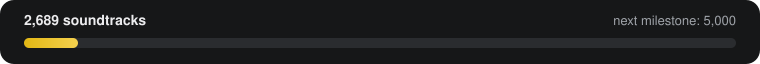

  

<h1 align="center">OSTDB</h1>

<b>The open database of official video game soundtracks.</b> Every game, its OST, and where to stream it: Spotify, Apple Music and album.link.

  <a href="https://ostdb.net"><b>Website</b></a> &middot;
  <a href="https://ostdb.net/api"><b>API</b></a> &middot;
  <a href="#-download-the-data"><b>Download the data</b></a> &middot;
  <a href="#-add-a-soundtrack-in-2-minutes"><b>Contribute</b></a> &middot;
  <a href="games/README.md"><b>Browse all games</b></a>

> [!TIP]
> **🎃 Hacktoberfest 2026:** adding a missing soundtrack is a perfect first pull request. Pick a game from **Most wanted** below, click **Add it**, fill in the links, and open the PR. Merged PRs count towards Hacktoberfest.

## 🆕 Recently added

<table>
<tr>
<td align="center" valign="top" width="16%"> <b>Lost Echo</b></td>
<td align="center" valign="top" width="16%"> <b>We Know the Devil</b></td>
<td align="center" valign="top" width="16%"> <b>Timelie</b></td>
<td align="center" valign="top" width="16%"> <b>NieR Re[in]carnation</b></td>
<td align="center" valign="top" width="16%"> <b>Shovel Knight Dig</b></td>
<td align="center" valign="top" width="16%"> <b>Quarantine Circular</b></td>
</tr>
<tr>
<td align="center" valign="top" width="16%"> <b>I Am Dead</b></td>
<td align="center" valign="top" width="16%"> <b>Wings of Vi</b></td>
<td align="center" valign="top" width="16%"> <b>Simulacra 2</b></td>
<td align="center" valign="top" width="16%"> <b>Vampire: The Masquerade - Shadows of New York</b></td>
<td align="center" valign="top" width="16%"> <b>Floppy Knights</b></td>
<td align="center" valign="top" width="16%"> <b>Opus: Rocket of Whispers</b></td>
</tr>
</table>

## 🔥 Most wanted

The most popular games that still have no soundtrack on OSTDB. Find the official OST, click **Add it**, and open a pull request.

| # | Game | Search | Contribute |
|---:|---|---|---|
| 1 | **Ori and the Blind Forest: Definitive Edition** | [🔎 Find on Spotify](https://open.spotify.com/search/Ori%20and%20the%20Blind%20Forest%3A%20Definitive%20Edition%20soundtrack) | [✏️ Add it](https://github.com/OSTDB/soundtracks/edit/main/missing/O/19456-ori-and-the-blind-forest-definitive-edition.json) |
| 2 | **Palworld** | [🔎 Find on Spotify](https://open.spotify.com/search/Palworld%20soundtrack) | [✏️ Add it](https://github.com/OSTDB/soundtracks/edit/main/missing/P/151665-palworld.json) |
| 3 | **Deep Rock Galactic** | [🔎 Find on Spotify](https://open.spotify.com/search/Deep%20Rock%20Galactic%20soundtrack) | [✏️ Add it](https://github.com/OSTDB/soundtracks/edit/main/missing/D/27134-deep-rock-galactic.json) |
| 4 | **Don't Starve Together** | [🔎 Find on Spotify](https://open.spotify.com/search/Don't%20Starve%20Together%20soundtrack) | [✏️ Add it](https://github.com/OSTDB/soundtracks/edit/main/missing/D/17832-dont-starve-together.json) |
| 5 | **BioShock Remastered** | [🔎 Find on Spotify](https://open.spotify.com/search/BioShock%20Remastered%20soundtrack) | [✏️ Add it](https://github.com/OSTDB/soundtracks/edit/main/missing/B/34293-bioshock-remastered.json) |
| 6 | **Heroes of Might and Magic V** | [🔎 Find on Spotify](https://open.spotify.com/search/Heroes%20of%20Might%20and%20Magic%20V%20soundtrack) | [✏️ Add it](https://github.com/OSTDB/soundtracks/edit/main/missing/H/370-heroes-of-might-and-magic-v.json) |
| 7 | **Torchlight** | [🔎 Find on Spotify](https://open.spotify.com/search/Torchlight%20soundtrack) | [✏️ Add it](https://github.com/OSTDB/soundtracks/edit/main/missing/T/2480-torchlight.json) |
| 8 | **Call of Duty: Modern Warfare Remastered** | [🔎 Find on Spotify](https://open.spotify.com/search/Call%20of%20Duty%3A%20Modern%20Warfare%20Remastered%20soundtrack) | [✏️ Add it](https://github.com/OSTDB/soundtracks/edit/main/missing/C/24920-call-of-duty-modern-warfare-remastered.json) |
| 9 | **Need for Speed** | [🔎 Find on Spotify](https://open.spotify.com/search/Need%20for%20Speed%20soundtrack) | [✏️ Add it](https://github.com/OSTDB/soundtracks/edit/main/missing/N/10965-need-for-speed.json) |
| 10 | **Sid Meier's Civilization** | [🔎 Find on Spotify](https://open.spotify.com/search/Sid%20Meier's%20Civilization%20soundtrack) | [✏️ Add it](https://github.com/OSTDB/soundtracks/edit/main/missing/S/902-sid-meiers-civilization.json) |
| 11 | **Europa Universalis IV** | [🔎 Find on Spotify](https://open.spotify.com/search/Europa%20Universalis%20IV%20soundtrack) | [✏️ Add it](https://github.com/OSTDB/soundtracks/edit/main/missing/E/1904-europa-universalis-iv.json) |
| 12 | **Counter-Strike: Condition Zero** | [🔎 Find on Spotify](https://open.spotify.com/search/Counter-Strike%3A%20Condition%20Zero%20soundtrack) | [✏️ Add it](https://github.com/OSTDB/soundtracks/edit/main/missing/C/297-counter-strike-condition-zero.json) |
| 13 | **Resident Evil: Revelations 2** | [🔎 Find on Spotify](https://open.spotify.com/search/Resident%20Evil%3A%20Revelations%202%20soundtrack) | [✏️ Add it](https://github.com/OSTDB/soundtracks/edit/main/missing/R/7725-resident-evil-revelations-2.json) |
| 14 | **Divinity: Original Sin** | [🔎 Find on Spotify](https://open.spotify.com/search/Divinity%3A%20Original%20Sin%20soundtrack) | [✏️ Add it](https://github.com/OSTDB/soundtracks/edit/main/missing/D/5082-divinity-original-sin.json) |
| 15 | **LEGO Star Wars: The Video Game** | [🔎 Find on Spotify](https://open.spotify.com/search/LEGO%20Star%20Wars%3A%20The%20Video%20Game%20soundtrack) | [✏️ Add it](https://github.com/OSTDB/soundtracks/edit/main/missing/L/2681-lego-star-wars-the-video-game.json) |

More in **[missing/](missing/README.md)** (273,467 games).

## 🎵 Add a soundtrack in 2 minutes

No Git, no install: everything happens on GitHub in your browser.

1. Pick a game from **Most wanted** above (or any file in [missing/](missing/README.md)) and click **✏️ Add it**.
2. Paste the album's **Spotify**, **Apple Music** or **album.link** URL, the album name and its cover URL. Delete the `_readme` line.
3. Choose **Create a new branch and start a pull request**, then **Propose changes**.

A bot checks the album and posts both covers on your PR; once it's approved, the soundtrack appears on [ostdb.net](https://ostdb.net) within minutes. Rather use a form? [Submit on ostdb.net](https://ostdb.net/submit). Full guide: **[SUBMITTING.md](SUBMITTING.md)**.

## 📦 Download the data

| Format | Link |
|---|---|
| JSON | [all-games.json](all-games.json) (updated with every soundtrack) |
| CSV, one row per album | [ostdb.csv](https://github.com/OSTDB/soundtracks/releases/latest/download/ostdb.csv) |
| SQLite | [ostdb.sqlite](https://github.com/OSTDB/soundtracks/releases/latest/download/ostdb.sqlite) |
| REST API | [ostdb.net/api](https://ostdb.net/api) |

Weekly snapshots are on the **[Releases](https://github.com/OSTDB/soundtracks/releases)** page. Games without a soundtrack yet are in **[missing.json](missing.json)**.

## 🏆 Contributors

Everyone who added or fixed a soundtrack. Thank you!

## 📚 Browse

All 2,181 games with a soundtrack, by letter: **[games/](games/README.md)**.

## License & credit

The OSTDB data is licensed under **[CC BY-NC-SA 4.0](LICENSE)**: free for non-commercial use, credit required, share alike. Wherever you use it, credit it visibly with a link:

> Data from [OSTDB (ostdb.net)](https://ostdb.net)

Commercial use needs permission ([support@ostdb.net](mailto:support@ostdb.net)). Album art, game art and IGDB metadata are not covered and belong to their owners. OSTDB is a non-commercial fan project, not affiliated with Spotify, Apple, IGDB or any game company. Details in **[NOTICE.md](NOTICE.md)**.

---

Generated by <a href="https://github.com/OSTDB/soundtracks-sync">ostdbbot</a> &middot; 2,663 soundtracks &middot; last updated 2026-10-28T11:57:03.647Z
